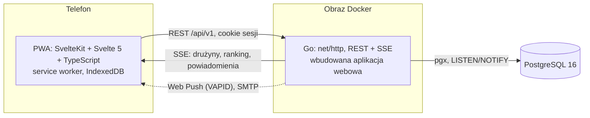

# UniQuest

[](https://github.com/git-maks/PL-App/actions/workflows/ci.yml)
[](https://github.com/git-maks/PL-App/actions/workflows/image.yml)

Aplikacja dla kandydatów, uczniów i studentów Politechniki Lubelskiej. Podczas wydarzeń na kampusie (dni otwarte,
warsztaty, Noc Naukowców) uczestnik skanuje kody QR na stacjach, ocenia zajęcia, a aplikacja buduje jego profil
kompetencyjny w formie karty postaci RPG i dopasowuje do niego kierunki studiów oraz koła naukowe. Poza wydarzeniami
jest kompendium wiedzy o uczelni: 6 wydziałów, 31 kierunków, 65 kół naukowych, mapa kampusu, rekrutacja i życie studenckie.

Aplikacja działa jako PWA: otwiera się z linku lub kodu QR, instaluje się na ekranie głównym Androida i iOS, działa
offline, bez sklepu z aplikacjami.

## Spis treści

- [Funkcje](#funkcje)
- [Architektura](#architektura)
- [Szybki start](#szybki-start)
- [Wdrożenie](#wdrożenie)
- [Testy i jakość](#testy-i-jakość)
- [Struktura repozytorium](#struktura-repozytorium)
- [Dokumentacja](#dokumentacja)
- [Zasady pracy z repozytorium](#zasady-pracy-z-repozytorium)

## Funkcje

**Dla uczestnika**

- Start bez rejestracji: pseudonim i opcjonalne selfie, zamieniane na urządzeniu w pikselowy awatar.
  Konto e-mail (logowanie kodem jednorazowym) przenosi postęp na inne urządzenie.
- Skaner QR w aplikacji (natywny `BarcodeDetector`, a w razie braku zxing-wasm) albo zwykły aparat telefonu.
  Kody stacji zmieniają się co 30 sekund i są podpisane HMAC, więc zdjęcie kodu szybko traci ważność.
  Kod ręczny z 6 znaków dla osób bez aparatu.
- Ocena zajęć w skali 1–5 przesuwa statystyki postaci (8 atrybutów i archetypów, np. Konstruktor, Analityk, Badacz).
- Karta postaci po pięciu ocenionych aktywnościach: tytuł, wykres radarowy, opis ścieżki, grafika do udostępnienia.
- Rekomendacje kierunków i kół naukowych (podobieństwo profilu do profili kierunków).
- Drużyny do 5 osób, dołączanie przez kod QR zaproszenia, bonus za wspólne zadania, ranking na żywo.
- Zadania, mapa kampusu, przypomnienia o sesjach (Web Push), odznaki.
- Tryb offline: zeskanowane kody czekają w kolejce i wysyłają się po odzyskaniu sieci.

**Dla organizatorów**

- Panel stacji: rotujący kod QR na ekranie lub rzutniku, kod ręczny, otwieranie okna skanowania, plakat do druku
  dla stacji bez ekranu.
- Panel administratora: analityka wydarzenia, eksport CSV (zagregowany, anonimowy), edycja wag stacji, uprawnienia,
  komunikaty push do uczestników.

**Interfejs**

Material Design 3 (tokeny kolorów, typografii, kształtów i ruchu jako zmienne CSS), jasny i ciemny motyw, krótkie
animacje z obsługą `prefers-reduced-motion`, zgodność z WCAG 2.1 AA sprawdzana automatycznie (axe-core).

## Architektura



| Część | Technologia | Katalog |
|---|---|---|
| Aplikacja (PWA) | SvelteKit 3, Svelte 5, TypeScript (strict), Vite, własny service worker | `apps/web` |
| Backend | Go (biblioteka standardowa `net/http`, `pgx`), sesje po stronie serwera, SSE, Web Push | `apps/api` |
| Baza danych | PostgreSQL 16, migracje SQL uruchamiane przy starcie | `apps/api/migrations` |
| Kontrakt API | OpenAPI 3.1, z którego generowane są typy TS; test zgodności tras po stronie Go | `packages/contracts` |
| Wspólna logika | punktacja i weryfikacja kodów QR zaimplementowane w TS i Go, sprawdzane tymi samymi danymi testowymi | `packages/contracts/fixtures` |
| Treści | baza wiedzy o PL w JSON, każdy fakt ze źródłem i datą weryfikacji | `content` |
| Wdrożenie | jeden obraz Docker, Docker Compose, Caddy (HTTPS) | `deploy` |

Frontend ma dwa backendy za wspólnym interfejsem `ApiClient`: `HttpApi` (serwer Go) oraz `DemoApi`, czyli cała logika
serwera uruchomiona w przeglądarce, z prawdziwą weryfikacją podpisów kodów QR. Dzięki temu demo działa jako statyczna
strona (GitHub Pages), bez serwera i bazy danych.

Uzasadnienie wyborów technologicznych i warianty rozważane w projekcie: [docs/SPECYFIKACJA.md](docs/SPECYFIKACJA.md).

## Szybki start

Wymagania: Node.js 22.17+, Go (wersja z `go.mod`), PostgreSQL 16 (lokalnie albo w Dockerze).

```bash
make install    # zależności frontendu
make dev-db     # opcjonalnie: PostgreSQL w Dockerze
make dev-api    # API na :8080, wydarzenie demo na dziś, konto administratora admin@pollub.test
make dev-web    # aplikacja na http://localhost:5173 (proxy /api do :8080)
```

Logowanie jako organizator: *Profil → Dodaj e-mail → admin@pollub.test*. W trybie deweloperskim kod logowania
pojawia się w aplikacji zamiast w e-mailu. Panel stacji jest pod `/staff`, panel administratora pod `/admin`.

Sama aplikacja bez backendu (dane w przeglądarce):

```bash
cd apps/web && PUBLIC_API_MODE=demo npm run dev
```

Cały stos w kontenerach:

```bash
docker compose -f deploy/compose.yaml up --build -d
docker compose -f deploy/compose.yaml run --rm app seed -admin admin@pollub.test
# http://localhost:8080
```

`make help` wypisuje wszystkie polecenia.

## Wdrożenie

Gałąź `main` jest zawsze gotowa do wdrożenia. Każdy push na `main` publikuje:

| Co | Gdzie | Workflow |
|---|---|---|
| Obraz produkcyjny (API + aplikacja) | `ghcr.io/git-maks/pl-app:latest` oraz `:sha-<commit>`; tag `v1.2.3` daje `:1.2.3` | `image.yml` |
| Demo bez serwera | `https://git-maks.github.io/PL-App/` | `pages.yml` |

Demo na GitHub Pages wymaga jednorazowego włączenia: *Settings → Pages → Build and deployment → Source: GitHub Actions*.
Do tego czasu workflow buduje demo i pomija publikację.

**Serwer produkcyjny** (VPS lub maszyna uczelniana z Dockerem, domena wskazująca na serwer):

```bash
git clone https://github.com/git-maks/PL-App.git && cd PL-App
cp deploy/.env.example deploy/.env    # domena, hasło bazy, SMTP, klucze VAPID
C="docker compose -f deploy/compose.yaml --env-file deploy/.env --profile https"
$C pull app && $C up -d --no-build
$C run --rm app seed -date 2027-04-01 -admin organizator@example.pl
```

Caddy automatycznie pobiera certyfikat HTTPS. Ten sam obraz działa na platformach PaaS (Fly.io, Cloud Run) z
zarządzanym PostgreSQL. Zmienne środowiskowe, warianty hostingu, procedura wydarzenia i lista kontrolna:
[docs/WDROZENIE.md](docs/WDROZENIE.md).

## Testy i jakość

```bash
make test           # svelte-check, Vitest, go vet, testy Go (wymagają PostgreSQL)
make e2e            # Playwright na wersji demo: onboarding, skan symulowaną kamerą, karta, drużyny, WCAG
make e2e-fullstack  # Playwright na serwerze Go: panel stacji, kod, ocena, plakat, drużyna na żywo przez SSE
```

CI (`.github/workflows/ci.yml`) uruchamia przy każdym pushu i pull requeście:

- typy, testy jednostkowe i e2e frontendu, budżet rozmiaru JavaScriptu (powłoka do 80 KB, trasa do 50 KB po gzip),
- `gofmt`, `go vet`, testy Go z `-race` na PostgreSQL, `govulncheck`,
- testy e2e całego stosu,
- budowę obrazu Docker.

## Struktura repozytorium

```
apps/
  web/                 aplikacja SvelteKit (PWA)
    src/lib/game/      silnik punktacji, czyste funkcje zgodne 1:1 z Go
    src/lib/api/       ApiClient: http.ts (serwer Go) i demo/ (backend w przeglądarce)
    src/lib/scanner/   kamera, BarcodeDetector, zxing-wasm
    src/lib/avatar/    selfie na pixel-art (na urządzeniu)
    src/lib/card/      karta postaci (Canvas) i Web Share
    src/routes/        ekrany aplikacji
    e2e/, e2e-fullstack/  testy Playwright
  api/                 backend Go
    cmd/uniquest/      serve, migrate, seed, gen-vapid, cleanup, health
    internal/app/      przypadki użycia: konta, skany, drużyny, powiadomienia, panel stacji, administracja
    internal/game/, internal/qr/  logika gry i kodów QR
    internal/httpapi/  REST, SSE i serwowanie aplikacji
    migrations/        schemat SQL
content/               baza wiedzy o uczelni (JSON)
packages/contracts/    OpenAPI i wspólne dane testowe
deploy/                Dockerfile, compose.yaml, Caddyfile, .env.example
docs/                  brief, specyfikacja, baza wiedzy, wdrożenie
tools/load/            test obciążeniowy k6
```

## Dokumentacja

- [Brief projektu](docs/BRIEF.md)
- [Specyfikacja i decyzje projektowe](docs/SPECYFIKACJA.md), w tym stan realizacji i odstępstwa (§19)
- [Baza wiedzy o Politechnice Lubelskiej ze źródłami](docs/BAZA_WIEDZY.md)
- [Wdrożenie i eksploatacja](docs/WDROZENIE.md)
- [Kontrakt API (OpenAPI)](packages/contracts/openapi.yaml)

## Zasady pracy z repozytorium

- Zmiany trafiają do `main` przez pull request z zielonym CI.
- Gałęzie robocze: `feature/…`, `fix/…`, `docs/…`; po scaleniu są usuwane.
- Wydania: tag `vX.Y.Z` na `main` publikuje obraz z numerem wersji.
- Treści o uczelni zmienia się w `content/`; każdy rekord ma pola `sources` i `verifiedAt`.
